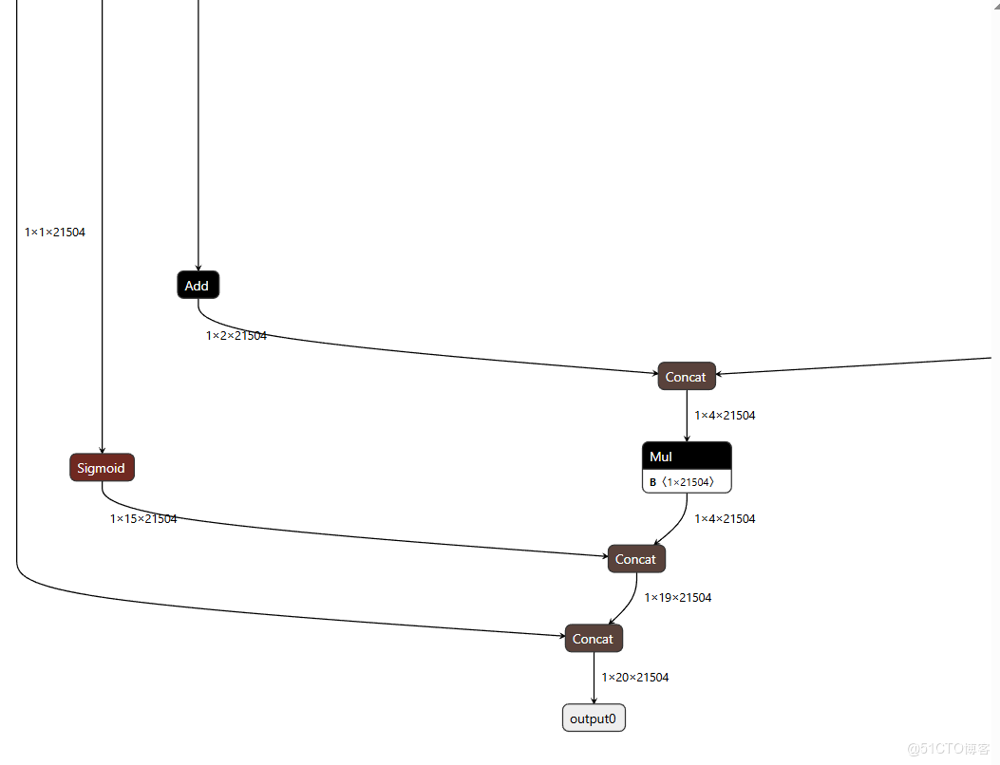
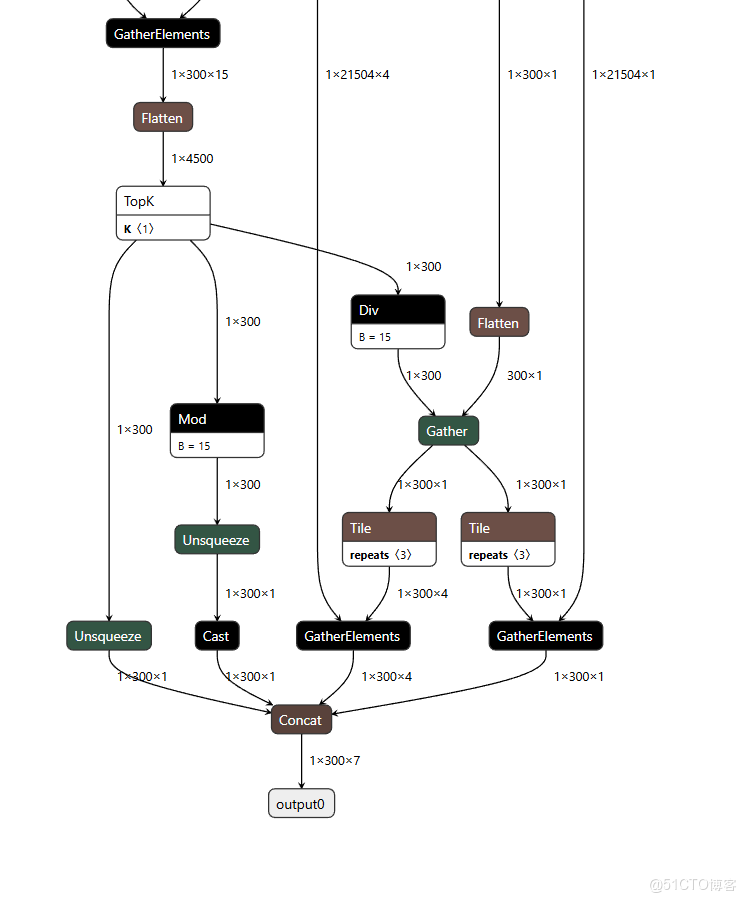
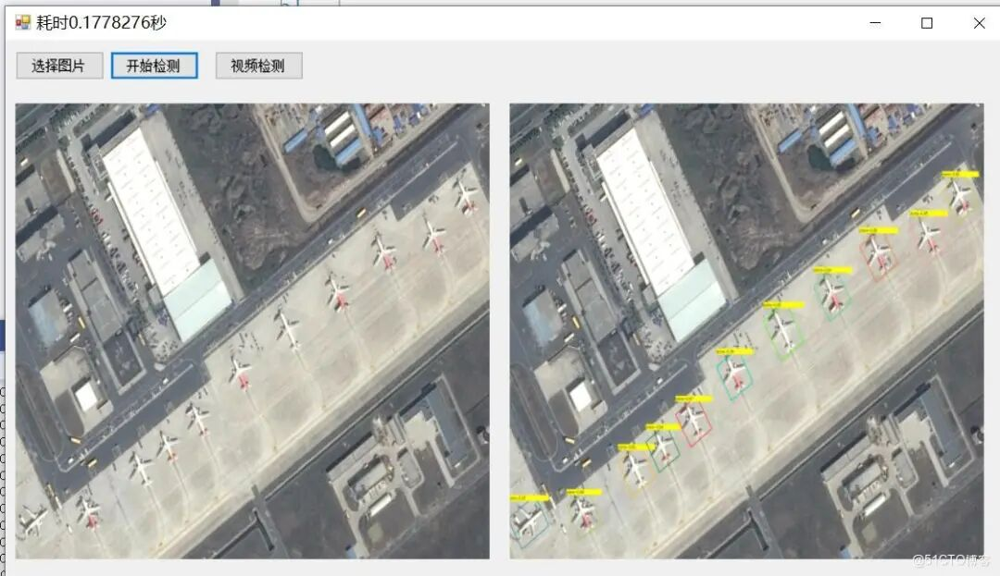

# C# Winform Deployment of the ONNX Model for Rotating Box Detection by Yolo26-OBB, Source Code + Model + Explanation

YOLOv26 has been officially released, so we can deploy the ONNX model for RoI Detection using C++ code. Firstly, let's look at the Yolo11n-obb network structure and notice that the output shape is 1x20x21504.



Let's take a look at the output of the Yolo26N-OBB network structure, which has an output shape of 1x300x7.



It is evident that the outputs from YOLOv11 and YOLOv26 are different, so the code cannot be shared.

The model uses the ONNX format converted from the official YOLOv2.6n-obb.pt, conversion command

yolo exportmodel=yolo26n-obb.pt format=onnx opset=12 

If you are training your own model, replace it accordingly. However, the Yolo26-OBB framework is required for testing.

VS2019 CPU inference, no need to install CUDA + cuDNN.

onnxruntime1.22.1 

opecvsharp4.11.0 

.net framework4.8.0 

ultralytics==8.4.0

Implementation of interface code and calling code:

-
-
-
-
-
-
-
-
-
-
-
-
-
-
-
-
-
-
-
-
-
-
-
-
-
-
-
-
-
-
-
-
-
-
-
-
-
-
-
-
-
-
-
-
-
-
-
-
-
-
-
-
-
-
-
-
-
-
-
-
-
-
-
-
-
-
-
-
-
-
-
-
-
-
-
-
-
-
-
-
-
-
-
-
-
-
-
-
-
-
-
-
-
-
-
-
-
-
-
-
-
-
-

```
using System;using System.Collections.Generic;using System.ComponentModel;using System.Data;using System.Diagnostics;using System.Drawing;using System.Linq;using System.Text;using System.Threading.Tasks;using System.Windows.Forms;using OpenCvSharp;
namespace FIRC{    public partial class Form1 : Form    {        OpenCvSharp.Mat src = new OpenCvSharp.Mat();        Yolo26ObbManager ym = new Yolo26ObbManager();        public Form1()        {            InitializeComponent();        }
private void button1_Click(object sender, EventArgs e)        {            OpenFileDialog openFileDialog = new OpenFileDialog(); openFileDialog.Filter = "Image files (*.*)|*.jpg;" *.png; *.jpeg; *.bmp"; openFileDialog.RestoreDirectory = true; openFileDialog.Multiselect = false; if (openFileDialog.ShowDialog() == DialogResult.OK)            {
                src = Cv2.ImRead(openFileDialog.FileName);                pictureBox1.Image = OpenCvSharp.Extensions.BitmapConverter.ToBitmap(src);
            }
        }
private void button2_Click(object sender, EventArgs e)        {            if(pictureBox1.Image==null)            {                return; }            Stopwatch sw = new Stopwatch(); sw.Start(); var result = ym.Inference(src); sw.Stop(); This.Text = "Elapsed" + sw.Elapsed.TotalSeconds + " seconds"; var resultMat = ym.DrawImage(src,result); pictureBox2.Image= OpenCvSharp.Extensions.BitmapConverter.ToBitmap(resultMat); //Convert Mat to Bitmap
        private void Form1_Load(object sender, EventArgs e)        {            ym.LoadWeights(Application.StartupPath+ "\\weights\\yolo26n-obb.onnx");
        }
        private void btn_video_Click(object sender, EventArgs e)        {            var detector = new Yolo26ObbManager();            detector.LoadWeights(Application.StartupPath + "\\weights\\yolo26n-obb.onnx");            VideoCapture capture = new VideoCapture(0);            if (!capture.IsOpened())            {                Console.WriteLine("video not open!");                return;            }            Mat frame = new Mat();            var sw = new Stopwatch();            int fps = 0;            while (true)            {
// Capture.Read(frame);
            capture.Release();
        }    }}
```

```

```

Final test results:




## Payment

Here is a pay link on Stripe ( https://buy.stripe.com/3cs8yP7sY87d0vu9AB ). Please contact me lonlonago@foxmail.com after funding $89, and I will send you a complete data files , thank you!


